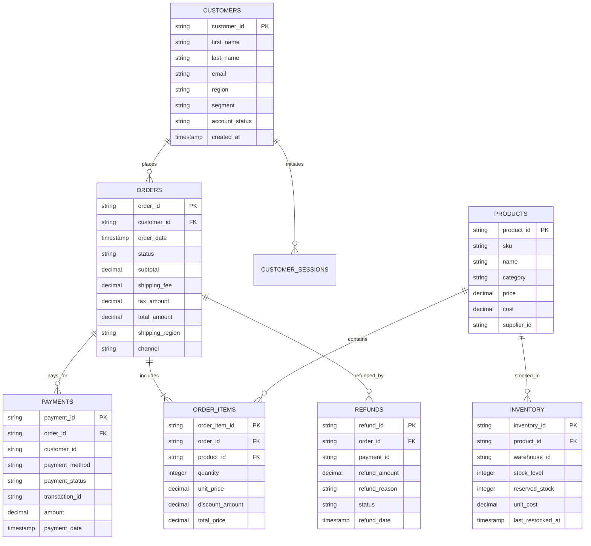

# Entity-Relationship & Star Schema Documentation

## 1. Operational Relational Schema (PostgreSQL)



---

## 2. Analytical Warehouse Star Schema (Kimball Model)

```
                 +-------------------+
                 |    dim_dates      |
                 +-------------------+
                 | date_key (PK)     |
                 | full_date         |
                 | month_name        |
                 | quarter           |
                 | year              |
                 +---------+---------+
                           |
                           v
+-------------------+    +--------------------+    +--------------------+
|   dim_customers   |--->|    fact_orders     |<---|    dim_products    |
+-------------------+    +--------------------+    +--------------------+
| customer_key (PK) |    | order_key (PK)     |    | product_key (PK)   |
| customer_id       |    | order_id           |    | product_id         |
| full_name         |    | customer_id (FK)   |    | sku                |
| email             |    | date_key (FK)      |    | name               |
| segment           |    | status             |    | category           |
| region            |    | total_amount       |    | unit_price         |
| effective_date    |    | shipping_fee       |    | unit_cost          |
| end_date          |    | tax_amount         |    | gross_margin_pct   |
| is_current        |    | shipping_region    |    +---------+----------+
+-------------------+    +---------+----------+              |
                                   |                         |
                                   v                         v
                         +--------------------+    +---------+----------+
                         |   fact_payments    |    |  fact_order_items  |
                         +--------------------+    +--------------------+
                         | payment_key (PK)   |    | order_item_key(PK) |
                         | order_id (FK)      |    | order_id (FK)      |
                         | date_key (FK)      |    | product_id (FK)    |
                         | payment_method     |    | quantity           |
                         | amount             |    | total_price        |
                         | is_successful      |    | total_cost         |
                         +--------------------+    | gross_profit       |
                                                   +--------------------+
```

